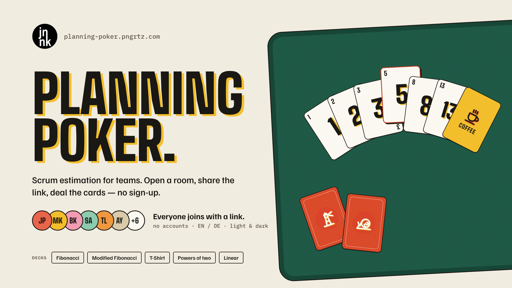

# Planning Poker

[](https://planning-poker.pngrtz.com)
[](https://planning-poker.pngrtz.com)

Scrum estimation. Open a room, share the link, deal the cards.

There is no database: a room only exists while people are in it. The browsers talk to each other through a tiny
WebSocket relay (`server/`, a Cloudflare Worker with one Durable Object per room) that forwards messages and keeps
no state. It only needs outgoing HTTPS/WSS, so it works from company networks, hotspots and mobile data alike. When
the last person leaves, the room is gone.



## Features

- Rooms with a shareable link, 8-character hex room codes
- Five fixed decks: Fibonacci, modified Fibonacci, T-shirt sizes, powers of two, linear (1–10), each with an abstain card
- Votes stay secret until everybody has voted (commit-reveal), then the table is revealed automatically
- Lowest, highest and average once revealed; consensus is highlighted
- The host can remove participants and start a new round; if the host leaves, the next person takes over
- English and German, light and dark theme, desktop-first with a mobile layout

## Stack

Next.js (App Router), TypeScript, Tailwind CSS, Zustand. The relay in `server/` runs on Cloudflare Workers + Durable Objects.

## Getting started

```bash
npm install
npm --prefix server install
npm run dev:server   # relay on ws://localhost:8787
npm run dev          # app on http://localhost:3000
```

| Script                     | Purpose                                                |
| -------------------------- | ------------------------------------------------------ |
| `npm run dev`              | Development server on http://localhost:3000            |
| `npm run dev:server`       | Relay server on ws://localhost:8787 (wrangler)         |
| `npm run build`            | Production build                                       |
| `npm test`                 | Unit tests and room logic against an in-memory network |
| `npm run typecheck`        | TypeScript check                                       |
| `npm run typecheck:server` | TypeScript check of the relay                          |
| `npm run lint`             | ESLint                                                 |
| `npm run format`           | Format the code with Prettier                          |

## Deploying the relay

The app stays on Vercel; only `server/` goes to Cloudflare.

1. `cd server && npx wrangler login && npx wrangler deploy` once. Wrangler prints the `*.workers.dev` URL.
2. In `server/wrangler.jsonc` set `ALLOWED_ORIGINS` to the origin of the app (localhost is always allowed).
3. In Vercel set `NEXT_PUBLIC_RELAY_URL` to `wss://<relay-host>` and redeploy.
4. For automatic deploys add the repository secrets `CLOUDFLARE_API_TOKEN` and `CLOUDFLARE_ACCOUNT_ID`; the
   workflow in `.github/workflows/relay.yml` then deploys on every push to `main` that touches `server/`.

## How it works

| Message       | Purpose                                                              |
| ------------- | -------------------------------------------------------------------- |
| `join`        | Name, join time and current vote state, sent to every new peer       |
| `config`      | Room name, deck, host and round, sent to newcomers by anyone present |
| `vote-commit` | A hash of the vote (never the value)                                 |
| `reveal`      | Value and salt, sent once everybody has voted                        |
| `reset`       | The host starts the next round                                       |
| `kick`        | The host removes a participant                                       |
| `leave`       | A participant leaves                                                 |
| `heartbeat`   | Presence plus a digest of the sender's state, so lost messages heal  |
| `host-change` | The host role moves to the next participant                          |

- **Secret votes.** A vote is sent as `SHA-256(round:id:value:salt)`. Once everybody has voted, each client reveals
  value and salt and all clients verify them against the hash.
- **Host succession.** Every client applies the same rule to the same data (longest present, smallest id on a tie), so
  all of them pick the same successor without a vote. An epoch counter settles diverging views.
- **Joining.** A newcomer receives the room configuration from the peers already present. If nobody answers within
  about eight seconds, the room is reported as not found or ended; an empty room is never created silently.

---

Created with ❤️ by [void](https://www.github.com/docVoid)
